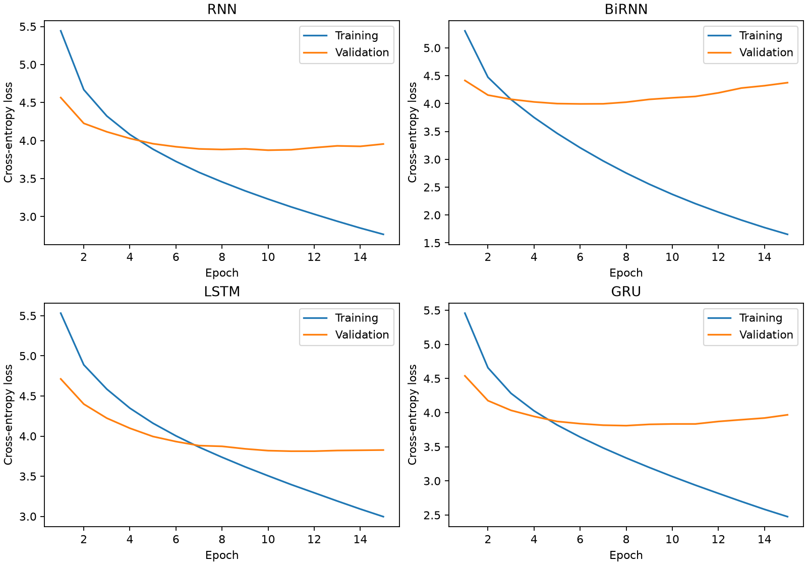
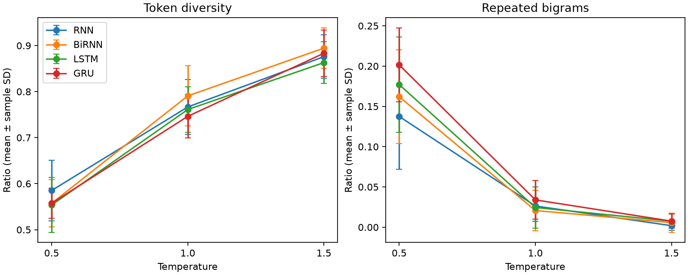

# Autoregressive Text Generation Using RNN, BiRNN, LSTM, and GRU

**Course:** Foundations of Generative AI (ICT4403)
**Assignment:** Assignment 2

## 1. Project Overview

This project implements and compares four recurrent neural network architectures for word-level autoregressive text generation:

* Simple Recurrent Neural Network (RNN)
* Bidirectional Recurrent Neural Network (BiRNN)
* Long Short-Term Memory (LSTM)
* Gated Recurrent Unit (GRU)

The models are trained to predict the next word in a sequence. Their performance is compared using quantitative metrics and qualitative analysis of generated text.

The project also investigates how sampling temperature affects coherence, diversity, contextual consistency, and repetition.

## 2. Dataset

**Dataset:** Alice's Adventures in Wonderland
**Author:** Lewis Carroll
**Source:** Project Gutenberg

Dataset source page: https://www.gutenberg.org/ebooks/11

Plain-text dataset: https://www.gutenberg.org/files/11/11-0.txt

### Preprocessing

The dataset is processed using the following steps:

1. Remove the standard Project Gutenberg header and footer when available.
2. Convert text to lowercase.
3. Tokenize words, contractions, numbers, and punctuation.
4. Split the tokens into training, validation, and testing sets using an 80:10:10 ratio.
5. Construct a vocabulary using training data.
6. Map rare or unseen words to an unknown token.
7. Generate input-target sequences for next-word prediction.

Each input sequence contains 12 preceding tokens, and its target is the following token.

The same dataset splits and preprocessing procedure are used for all four models.


### Recorded dataset characteristics

The downloaded literary narrative contains **34,205 tokens** after boundary stripping and tokenization, with dialogue, punctuation and recurring characters. The training-only vocabulary has **1,323 entries**, including `<unk>`. Words occurring fewer than twice in training map to `<unk>`. Gutenberg front matter within the START/END boundaries is retained.

| Split | Tokens | 12-token examples | Unknown tokens |
|---|---:|---:|---:|
| Train | 27,364 | 27,352 | 3.79% |
| Validation | 3,420 | 3,408 | 9.04% |
| Test | 3,421 | 3,409 | 10.00% |

Splits are contiguous and made **before** constructing sliding windows, so adjacent overlapping windows never cross a split. This measures generalization to later sections of the book. The complete source text and its Gutenberg notice are saved in `data/alice.txt`; its SHA-256 is recorded in `dataset_stats.json`.

## 3. Models Implemented

### Simple RNN

The Simple RNN maintains a hidden state that is updated as each token is processed. It serves as the baseline recurrent architecture.

### Bidirectional RNN

The Bidirectional RNN processes the observed input sequence in forward and backward directions.

It uses information from both directions within the available context window to predict the next word.

### LSTM

The Long Short-Term Memory network uses input, forget, and output gates to regulate information flow through its cell state.

It is designed to help learn longer-term dependencies.

### GRU

The Gated Recurrent Unit uses update and reset gates to control information flow.

It provides a gated recurrent architecture with a different parameterization from LSTM.

## 4. Experimental Methodology

All four models use comparable experimental conditions, including:

* The same dataset and preprocessing procedure
* The same training, validation, and testing splits
* The same input sequence length
* The same embedding and hidden dimensions
* The same optimizer and learning rate
* The same number of training epochs

The model checkpoint with the lowest validation loss is selected for evaluation.

Recorded configuration: seed 42, context 12, embedding size 64, hidden size 128 per direction, one recurrent layer, batch size 128, Adam learning rate 0.001, gradient-norm clipping 1.0, and 15 epochs for every model. CPU execution uses four PyTorch threads and deterministic algorithms. The shuffle generator is reset to the same seed for each model. Parameter counts differ because architectures and output widths differ; this is a shared-dimension, not parameter-matched, comparison.

Training time includes validation and best-state copies, but excludes preprocessing, test evaluation and generation. Package versions, hardware identification and configuration are in `run_metadata.json`; the exact installed environment is in `requirements-lock.txt`. Training uses one random initialization per architecture, so small performance differences are not statistically established.

## 5. Evaluation Metrics

The following metrics are used to compare the models.

### Test Loss

Measures the cross-entropy loss on held-out test examples. Lower values indicate better predictive performance under this objective.

### Perplexity

Perplexity is calculated by exponentiating the cross-entropy loss. Lower perplexity generally indicates that the model is better at predicting the next token.

### Next-Word Accuracy

Measures the proportion of test examples for which the model's highest-probability next-word prediction matches the actual target.

### Training Time

Measures the time required to train each model under the chosen experimental setup.

### Generated-Text Quality

Generated text is examined for:

* Coherence
* Diversity
* Contextual consistency
* Repetition

Additional diagnostics include unique-token ratio and repeated-bigram ratio.

## 6. Sampling Temperature Analysis

Each model generates text from the same seed sequence at three temperature values:

* **Temperature = 0.5:** Lower-temperature sampling generally produces more conservative predictions.
* **Temperature = 1.0:** Standard temperature sampling provides a baseline for comparison.
* **Temperature = 1.5:** Higher-temperature sampling generally produces more random predictions.

The generated samples are compared to determine how temperature affects diversity, repetition, and contextual consistency.

Conclusions are based on the generated samples and measured diagnostics.

## 7. Results

Measured on 17 October 2026 by running `experiment.py` with the configuration above.

| Model | Test loss | Perplexity | Accuracy | Training (s) | Best epoch | Parameters |
|---|---:|---:|---:|---:|---:|---:|
| RNN | 4.0028 | 54.75 | 24.20% | 55.77 | 10 | 280,171 |
| BiRNN | 4.1179 | 61.43 | 23.97% | 108.05 | 6 | 474,347 |
| LSTM | 3.9380 | 51.32 | 26.14% | 101.05 | 11 | 354,667 |
| GRU | 3.9573 | 52.32 | 25.73% | 99.51 | 8 | 329,835 |

Cross-entropy is the mean natural-log loss over test targets; perplexity is its exponential. Accuracy includes punctuation and unknown tokens. These are next-token metrics for word-level tokenization, not words-only accuracy. Full precision is preserved in `model_comparison_results.csv`.



## 8. Generated Text Analysis

Each model generated 60-token continuations for three shared prompts, temperatures 0.5, 1.0 and 1.5, and three random sampling repeats: **108 samples**. The same sampling RNG seeds are reused across models and temperatures. `<unk>` is suppressed only during generation; evaluation probabilities remain unchanged. Prompts and all continuations are in `generated_text_samples.csv`.

Unique-token ratio is the number of distinct continuation tokens divided by 60. Repeated-bigram ratio is one minus distinct continuation bigrams divided by 59. Neither includes the prompt. The table shows averages over nine continuations per model/temperature; sample standard deviations are in `generation_diagnostics.csv`.

| Model | Temperature | Unique-token ratio | Repeated-bigram ratio |
|---|---:|---:|---:|
| BiRNN | 0.5 | 0.557 | 0.162 |
| BiRNN | 1.0 | 0.791 | 0.021 |
| BiRNN | 1.5 | 0.894 | 0.006 |
| GRU | 0.5 | 0.557 | 0.202 |
| GRU | 1.0 | 0.746 | 0.034 |
| GRU | 1.5 | 0.883 | 0.008 |
| LSTM | 0.5 | 0.554 | 0.177 |
| LSTM | 1.0 | 0.761 | 0.024 |
| LSTM | 1.5 | 0.863 | 0.008 |
| RNN | 0.5 | 0.585 | 0.137 |
| RNN | 1.0 | 0.767 | 0.026 |
| RNN | 1.5 | 0.876 | 0.002 |



### Representative continuations

The following are the first 35 whitespace-separated items of seed 0, sampling repeat 0; the full 60-token outputs are in the CSV. The shared prompt is: “alice was beginning to get very tired of sitting by her sister”.

**RNN, temperature 0.5:**

> in a low tone, “ and they all crowded round the door, you know, you know, ” said alice. “ what did you know! ” “ then, ” said alice, who was the first, “ …

**RNN, temperature 1.0:**

> in a english tone; “ and they met now eagerly fond like to of them cautiously a little girls stand must remember into right for voice, and just very almost some got getting off, while …

**RNN, temperature 1.5:**

> alice's getting the “ but first run — i'm thing eagerly fond watching gave of them cautiously began mabel? stand must learn into right for poor sad v just very almost some got getting off …

**BiRNN, temperature 0.5:**

> , and the other moment she had in a moment eagerly, and she was the little thing of her head. “ what was is, ” said the pigeon, in a tone of the table, and …

**BiRNN, temperature 1.0:**

> alice's. the “ but, there's — i'm sure eagerly fond like quarrelling of them cautiously their mabel? stand must remember the right were. also v just felt almost then got! well, “ you i will …

**BiRNN, temperature 1.5:**

> alice's golden the “ but better run — out and eagerly fond pebbles tail of them cautiously began without? stand must remember into right for poor also v just felt almost then got! well there …

**LSTM, temperature 0.5:**

> in a little of the house, and she went on, and she walked up and began to herself, “ if you was not like a little girl, ” said the hatter: “ but you don't …

**LSTM, temperature 1.0:**

> in getting english out round, and they met and eagerly fond a tail of them cautiously! ” and stand must began into right, and they were just very almost some got of the words, who …

**LSTM, temperature 1.5:**

> in getting english out round first run — but and eagerly fond watching gave of them cautiously their mabel? stand must learn into right for poor sad v just felt almost then got! well there …

**GRU, temperature 0.5:**

> in a minute or two, and she went on eagerly, and she walked off her arms, and she swam began to be a little of the wood, and then to the other of a little …

**GRU, temperature 1.0:**

> in a most tea - doors, in the table eagerly, with gave of them cautiously began without gone of the rabbit. which were voice, “ just very almost some got! well, tell you live the …

**GRU, temperature 1.5:**

> in getting the tree round, run — “ and everybody fond watching gave of them cautiously began here? stand must turtle into right, poor they v just felt almost some got! well there saw the …

### Interpretation of the observed samples

At temperature **0.5**, all four models produce recognizable dialogue fragments and Alice-related vocabulary, but repeat common constructions. RNN repeats “you know, you know”; LSTM repeats “you see”; GRU repeatedly returns to “a little”. BiRNN produces local syntactic failures such as “what was is”. Familiar characters do not imply a coherent story: LSTM moves from the sister prompt to the Hatter and Mock Turtle, while GRU introduces a golden key and the Conqueror without a consistent transition. The other prompts show similar drift: the Queen prompt produces repeated Queen mentions in LSTM but disconnected events, and the Hatter prompt soon switches speakers to the Queen, Alice and Duchess.

At **1.0**, lexical diversity rises to 0.746–0.791 and repeated-bigram ratios fall to 0.021–0.034, but grammatical quality often deteriorates. GRU's “in a most tea - doors” and RNN's “in a english tone” illustrate that this middle temperature is not automatically a good balance for these small models.

At **1.5**, unique-token ratios reach 0.863–0.894 and repeated-bigram ratios are below 0.008. Samples nevertheless resemble loosely connected word sequences, with weak contextual consistency. The increased diversity is primarily randomness, not demonstrated creativity. Shared sampling random numbers can yield similar fragments across models when their distributions become flatter; these samples are paired comparisons, not independent draws across models.

For readable short fragments, **0.5 is the most useful of the three tested temperatures**, accepting more repetition. None reliably sustains a coherent 60-token narrative. This is an informal qualitative reading of the supplied samples, not a blinded human-rating study; it does not establish a robust semantic-quality ranking between LSTM and GRU.

## 9. Model Comparison and Conclusion

**LSTM is the best-performing model on the recorded test comparison**, with the lowest test loss (3.9380), lowest perplexity (51.32) and highest accuracy (26.14%). At temperature 0.5 it also produces recognizable short narrative and dialogue fragments, although its sustained coherence remains poor. It is the preferred model for this assignment's measured predictive comparison, rather than a proven universal winner in text quality.

GRU is close: perplexity 52.32, accuracy 25.73%, 329,835 parameters and 99.51 seconds of training, compared with LSTM's 354,667 parameters and 101.05 seconds. **GRU actually has the lowest validation loss (3.8094 versus LSTM's 3.8122)**, so a model selected strictly before looking at test outcomes would be GRU. The LSTM conclusion is a descriptive ranking of this held-out comparison; no hyperparameters or training budgets were changed in response to test results. The small gaps require repeated training seeds to establish robustness.

RNN is the cheapest baseline: 55.77 seconds and 280,171 parameters, with perplexity 54.75. BiRNN has the most parameters (474,347), takes 108.05 seconds and has the worst test perplexity (61.43). Its validation loss bottoms out at epoch 6 while training loss continues falling, consistent with overfitting under this setup. Bidirectionality within a short observed prefix did not improve this experiment.

Use LSTM at temperature 0.5 when prioritizing this run's predictive results and readable fragments, or GRU when preferring its slightly smaller size and validation-selected checkpoint. Increasing temperature improves lexical variety at a clear cost to grammar and contextual consistency. All conclusions are restricted to one book, one split and one training initialization.

## 10. Limitations

* The experiment uses a single literary text.
* The vocabulary size is limited.
* Approximately 10% of test tokens map to `<unk>`. Perplexity and accuracy therefore describe the reduced vocabulary, and cannot be compared directly with full-vocabulary language models.
* The models are relatively small and use a limited training budget.
* Automatic diversity metrics do not fully capture semantic quality.
* Generated text can vary because sampling is stochastic.
* A bidirectional model uses both directions within its observed context window; it does not receive the target word as input.

## 11. How to Run

### Requirements

* Python 3.10 or newer recommended
* PyTorch
* NumPy
* pandas
* Matplotlib
* Jupyter Notebook

### Installation

Create and activate a virtual environment, then install the required packages.

```bash
pip install -r requirements.txt
```

Launch Jupyter Notebook:

```bash
jupyter notebook
```

Open `FGAI_Assignment2_Text_Generation.ipynb` and run all cells. The supplied executed notebook displays the saved measured experiment. Set `RETRAIN = True` in its training cell to train again, evaluate, generate samples and overwrite the CSVs and plots. If results are absent, training runs automatically.

Alternatively, run the complete training experiment directly:

```bash
python experiment.py
python test_experiment.py
python verify_results.py
```

Use Python 3.12 and `pip install -r requirements-lock.txt` to reproduce the recorded package environment. The broader `requirements.txt` permits compatible installations. The dataset is bundled; if missing, the experiment downloads it from the stated Gutenberg URL. Model checkpoints are saved locally under `checkpoints/` and are excluded from Git. Training is CPU-based and took a few minutes on the recorded machine; other hardware can differ. Rerunning the experiment updates results but does not automatically rewrite this README's interpretation.

## 12. Repository Contents

* `FGAI_Assignment2_Text_Generation.ipynb`: Model implementation and experiments
* `requirements.txt`: Required Python packages
* `model_comparison_results.csv`: Quantitative model comparison
* `generated_text_samples.csv`: Generated text at different temperatures
* `generation_diagnostics.csv`: Text-diversity and repetition diagnostics
* `loss_curves.png`: Training and validation loss plots
* `temperature_diversity.png`: Temperature and lexical-diversity comparison

Additional supporting files:

* `experiment.py`: standalone training, evaluation, sampling and plotting implementation
* `test_experiment.py`: tokenization, sequence alignment, model gradient/directional-state and sampling checks
* `verify_results.py`: checks saved metrics, checkpoint selection, sample counts and plots
* `training_history.csv`: every epoch's training and validation loss
* `dataset_stats.json`, `vocabulary.json`, `data/alice.txt`: dataset provenance and preprocessing artifacts
* `run_metadata.json`, `requirements-lock.txt`: recorded environment and configuration

## 13. Acknowledgements

The text dataset is obtained from Project Gutenberg.

This project is developed for academic study of recurrent neural networks and autoregressive text generation.

